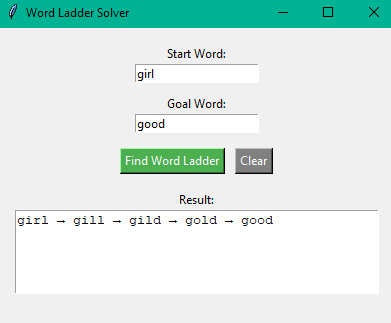

# Word Ladder Solver (Python)

A Python-based application that finds the shortest transformation sequence from a start word to a goal word, changing only one letter at a time. This project uses the **Breadth-First Search (BFS)** algorithm to guarantee the shortest path and includes both a Console and a GUI (Tkinter) version.

## Demo



## Features

- **Breadth-First Search (BFS):** Efficiently explores all possible word transformations, guaranteeing the shortest path to the target word.
- **Graphical User Interface (GUI):** Built with `tkinter` for an intuitive user experience. Users can input start and goal words and view the results instantly.
- **Dictionary Filtering:** Automatically loads a dictionary (`wordList.txt`), cleans the text (removes spaces, converts to lowercase), and filters by word length to optimize the search space.
- **Error Handling:** Gracefully handles missing files, empty dictionaries, words of different lengths, or unreachable targets.

## Tech Stack

- **Language:** Python 3
- **Libraries:** `tkinter` (GUI), `collections.deque` (BFS Queue)
- **Algorithm:** Breadth-First Search (BFS)

## Getting Started

### Prerequisites
- Python 3.x installed.

### Installation
1. Clone the repository or download the files.
2. Ensure `wordList.txt`, `word_ladder_gui.py`, and `word_ladder_console.py` are in the same folder.

### Running the GUI Version (Recommended)
```bash
python word_ladder_gui.py
